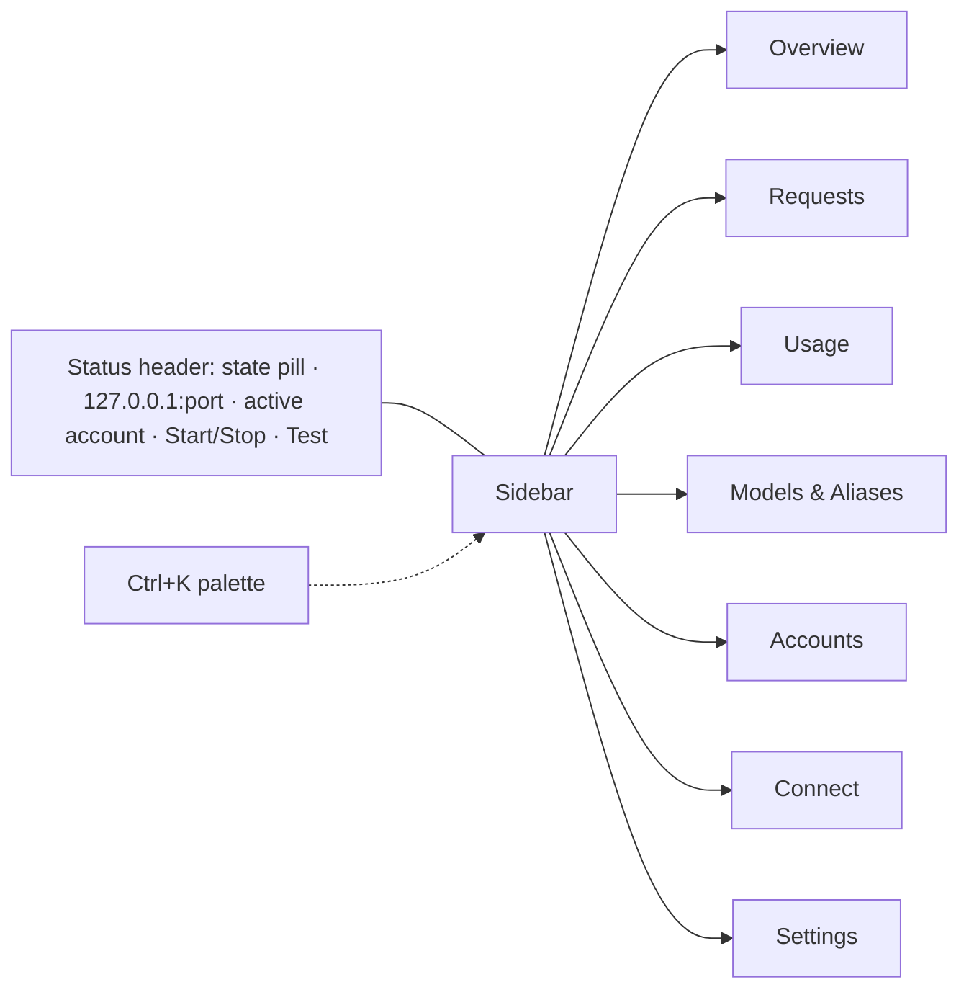

# MLAI Bridge — UI/UX Redesign Plan

Compiled from three research surveys (about 90 primary sources, each linked in the detail files):

- [research/gateways.md](research/gateways.md): hosted and self-hosted LLM gateways (OpenRouter, Vercel AI Gateway, Cloudflare, LiteLLM, Bifrost, Portkey, Helicone, Langfuse, Kong, LM Studio).
- [research/local-apps.md](research/local-apps.md): local and desktop tools close to ours (EasyCLIProxyAPI, claude-code-router, New API, Antigravity Manager, Kiro proxies, LM Studio, Ollama, Jan, Cherry Studio, Clash Verge Rev, v2rayN, HTTP Toolkit, Proxyman, Charles).
- [research/stack.md](research/stack.md): the React stack, Tauri plugins, the Windows 11 look and pitfalls.

Our app is **single-user, local and desktop-first**. Multi-tenant SaaS features (teams, budgets per key, guardrails, routing graphs) are out of scope.

---

## 1. Design principles (from the research)

1. **Honest state.** Never show `0` when the real value is "unknown". Never show onboarding when the backend failed (claude-code-router #1832). Keep "local server" state separate from "upstream reachable".
2. **Copy, don't write.** Client configs are copied by default. Any file write is backed up first, shows a diff, and offers Restore (claude-code-router #1575 backlash vs EasyCLI).
3. **Opt-in background behaviour.** Autostart, start hidden and close-to-tray are separate, visible toggles, all off by default (Ollama #8783 backlash).
4. **Inspector-grade logs.** Full bodies are never truncated (LM Studio #300). Filters, pause/live, "N of M shown", copy as cURL.
5. **Health checks use the real path.** "Test" sends a tiny real request through the proxy (Cherry Studio #13592).
6. **Calm UI.** Dense, keyboard-friendly, Linear/Vercel style. Live charts can be paused to save GPU (Clash Verge FAQ).

---

## 2. Information architecture

Replace the three top tabs with a **left sidebar**. A status header is always visible.

| New page | Replaces / adds |
|---|---|
| Overview | Status card, Test connection, 4 metric cards, last 10 requests, quick connect tiles |
| Requests | Log table + detail drawer (moved out of the Usage tab) |
| Usage | Charts and per-model/per-account breakdowns |
| Models & Aliases | Alias editor + model list + mint limits |
| Accounts | Account cards with health and quota |
| Connect | Per-client config snippets + troubleshooting |
| Settings | Port, API key, theme, autostart/tray, body storage and retention, updates |

---

## 3. Screen-by-screen spec

### 3.1 Status header (all pages)
- Pill: `Stopped` / `Starting` / `Running` / `Port in use` / `Error`, with a text label and a colour (not colour alone).
- A second small indicator shows that the upstream is reachable, with the time of the last success.
- One large Start/Stop toggle. While it is busy, the label stays and a spinner shows.
- **Test** button: sends one minimal real request and shows the latency and the result in a toast. *(EasyCLIProxyAPI, LM Studio, LiteLLM)*

### 3.2 Overview
- Metric cards: Requests, Tokens, Cache-hit %, Credits. Each has a sparkline and a change vs the previous period. *(OpenRouter, Kong)*
- A mini list of the latest requests. Clicking one opens the Requests drawer.
- **First run:** a three-step checklist (Add account → Start proxy → Connect a client). It shows only when the backend confirms the config is empty. If the backend is unreachable, a separate error screen shows instead.

### 3.3 Requests (the most-used page)
- A virtualized table. Columns: time, status chip, requested alias → upstream model, account, effort, `in → out` tokens (hover shows the cached/reasoning split, and a dash means not reported), duration, TTFT. *(Vercel, Kong)*
- Above the table: a volume mini-chart. Drag across it to zoom the time range. *(Vercel)*
- Filter bar: multi-select for account, model, effort and status class (2xx/4xx/5xx). Search accepts a pasted request ID and jumps to it. One **Reset** button. Shows "N of M shown". *(Vercel, Bifrost, HTTP Toolkit)*
- A **Live** toggle replaces the auto-refresh checkbox. It pauses on scroll or while a request is open and shows an "N new" pill. *(Vercel, Helicone, Bifrost)*
- Row context menu: "Filter like this", Copy ID, Copy as cURL. *(HTTP Toolkit, Proxyman)*
- **Detail drawer:**
  - It is resizable, with previous/next buttons, and the request ID is kept in the route.
  - Fixed section order: Overview → Timing bar (start → first token → end, coloured green/amber/red) → Usage/Credits → Request → Response → Raw.
  - Bodies show in read-only CodeMirror with folding and search. A Tree/Raw toggle is optional.
  - Actions: Copy JSON, Copy as cURL.
  - When a body was not stored, the drawer says why (privacy setting or retention). *(OpenRouter, Vercel, Charles)*

### 3.4 Usage
- A time range picker (24h / 7d / 30d / custom).
- Stacked bar charts by model and by account. **Clicking a bar opens Requests with that filter.** *(OpenRouter)*
- A breakdown table for tokens in/out/cached/reasoning, cache-hit % and credits. Aliases expand to their upstream model.
- A "Pause live charts" switch. Charts are lazy-loaded.

### 3.5 Models & Aliases
- Aliases are an editable list, not a graph. Each row has alias → upstream `select`, an inline duplicate/invalid check and a **Test** button. *(Cloudflare, LiteLLM)*
- The upstream model list shows learned limits. "Mint limits" sits here.

### 3.6 Accounts
- One card per account:
  - Status dot and "last success X ago".
  - The last error text.
  - A quota/credits bar with "updated 3 min ago · resets in …", or **unknown** when there is no data.
  - Cooldown/rate-limit badge.
  - Token-expiry warning.
  *(Antigravity Manager, LiteLLM health, New API)*
- Buttons: **Check** per card and **Check all**. Both use the real request path.
- Add account opens a dialog with two choices: Device token or Import from mlai CLI. Batch import removes duplicates and verifies each account.
- Set active / Remove. Remove asks for confirmation in an alert dialog.

### 3.7 Connect
- One tile per client: **Cline, Roo Code, opencode, Cursor, curl, Python, PowerShell/bash env vars**.
- Each tile shows the exact fields that client uses, with the real base URL, a masked key (with reveal) and a suggested model alias already filled in. *(Vercel coding-agents table, HTTP Toolkit grid)*
- **Claude Code tile: show as "Not supported".** Our server only serves `/v1/chat/completions`, `/v1/models` and `/health`. Claude Code needs the Anthropic `/v1/messages` API. Add the tile only if a Messages endpoint is built later.
- The `/v1` warning: show the right base URL for each client.
- Troubleshooting by symptom: connection refused → proxy stopped or wrong port; 401 → key/header; 404 model → use an alias from the list. Plus "Open logs folder". *(Jan, Claude Code gateway docs)*

### 3.8 Settings
- **Port.** If the port is taken, show "Port 8080 is used by `<process.exe>` (PID n)" with **Use next free port** / Change / Retry, and detect Hyper-V reserved ranges. *(CLIProxyAPI #793, claude-code-router)*
- **API key**, with Regenerate and Copy.
- **Theme:** System / Light / Dark (default System).
- **Start with Windows**, **Start proxy on launch**, **Start hidden**, **Close to tray**. Each is a separate toggle and all are off by default.
- **Privacy:** a "Store request/response bodies" toggle, a retention period, and masking of anything shaped like a key or token.
- **Updates:** a check on launch shows "Update to vX". It opens release notes with an **Install & restart** button. It never installs without asking.

### 3.9 Tray (new)
- The icon changes with the state (running / stopped / error).
- Menu: Start/Stop · Copy base URL · Copy API key · Copy env (PowerShell/bash) · Open Requests · Open logs folder · Quit. *(Clash Verge Rev, v2rayN)*

### 3.10 Command palette (Ctrl+K)
Start/stop, switch account, copy base URL or key, go to a page, jump to a request ID.

---

## 4. Tech stack (details and versions in [research/stack.md](research/stack.md))

| Concern | Choice |
|---|---|
| Styling | Tailwind CSS v4 (`@tailwindcss/vite`) |
| Components | shadcn/ui on Base UI (code copied into `ui/src/components/ui`) |
| Icons / font | lucide-react, Geist + Geist Mono (bundled locally, `tabular-nums`) |
| Data | TanStack Query wrapping `invoke` (`networkMode: "always"`). Later, Rust emits a `request-logged` event to replace polling |
| Tables | TanStack Table v9 + TanStack Virtual |
| Charts | shadcn chart (Recharts), lazy-loaded |
| Body viewer | `@uiw/react-codemirror` + `@codemirror/lang-json` (read-only) |
| Palette / toasts | shadcn `command` (cmdk), shadcn/Base UI `toast` |
| Theme | Small ThemeProvider + Tauri `onThemeChanged` |

**Rejected:** Mantine (second styling system), Chakra v3 (runtime CSS-in-JS, large), HeroUI, Ant Design (too heavy, admin look), Tremor (stale), Monaco (workers and CSP friction), MUI.

**Tauri plugins to add:** `tray-icon` feature, `single-instance` (registered first), `autostart` (with `--minimized`), `window-state`, `clipboard-manager`, `notification`, `updater` + `process`, `opener`.

**Windows 11 look:** keep the native titlebar (keeps Snap Layouts) and add a Mica window effect. Set the window `backgroundColor` and show the window after first paint to stop the white flash.

---

## 5. Pitfalls to handle

- **Capabilities.** Every plugin command needs a permission in `crates/app/capabilities/default.json`. clipboard-manager grants nothing by default, so add `allow-write-text`. A ready-to-use file is in stack.md §5.
- **CSP.** It is `null` today. Set a real policy that includes the `ipc:` / `http://ipc.localhost` sources `invoke` needs (stack.md §5).
- **Vite build target.** Use ≥ `chrome111`, because Tailwind v4 needs it. The Tauri template's `chrome105` is too low.
- **WebView2.** Native `<select>` colours ignore dark mode, so use the shadcn Select. Turn off `dragDropEnabled` if HTML drag-and-drop is needed.
- **Mica.** It needs `transparent: true`. A known bug means the effect does not apply until a resize; stack.md has the workaround.
- **Counts must add up.** Keep one source of truth for token and credit totals (LiteLLM had to write a doc page explaining its gaps).
- **No silent truncation** of tables or bodies. Always show "N of M".

---

## 6. Build order

| Phase | Scope | Backend work needed |
|---|---|---|
| 1. Foundation | Tailwind + shadcn init, ThemeProvider, sidebar shell, status header, TanStack Query layer, CSP + capabilities, build target | None |
| 2. Requests | Virtualized log, filters, Live toggle, detail drawer with CodeMirror, Copy as cURL | Optional: `request-logged` event, status class in `RequestRow` |
| 3. Connect + Overview | Client tiles, troubleshooting, metric cards, first-run checklist, Test button | `test_connection` command |
| 4. Usage + Models | Charts with click-to-filter, range picker, alias editor with per-row Test | Time-bucketed usage query |
| 5. Accounts | Health cards, Check / Check all, quota freshness, expiry warnings | `accounts_check`, last-success/error fields |
| 6. Desktop polish | Tray, autostart/start-hidden/close-to-tray, single-instance, window-state, Mica, port-conflict dialog, updater, Ctrl+K | Port-owner lookup, updater endpoint + signing key |

Phases 1–3 cover the biggest UX gains and need very little Rust work.

### Progress

- **Phase 1: done.** Shell, sidebar, themes, TanStack Query, CSP. Screenshots in `ui/.screens/`.
- **Phase 2: done.** Virtualized log, multi-select filters, live/pause pill, resizable drawer with CodeMirror bodies and Copy as cURL, request id in the URL hash. Backend: the `history` limit cap was raised from 500 to 5000 so the log can show 2000 rows.
  - Deviation: the log table is built on `@tanstack/react-virtual` with hand-written sorting instead of TanStack Table v9. The log has fixed columns and three sort keys, so the table library added API surface without benefit.
  - Deferred: the Rust `request-logged` push event; the UI polls every 3 s while the proxy runs.
- **Phase 3: done.** Connect page with per-client cards (Cline, Roo Code, Cursor, opencode, curl, Python, shell env), masked keys with reveal, copy buttons, the /v1 trap note, symptom troubleshooting, and Claude Code shown as not supported. Overview gained sparkline cards, a first-run checklist, and a Test button that sends one real request through the proxy (new Rust `test_connection` command). The preview stub understands `?preview-empty` for the first-run state.
  - Deferred: the "vs previous period" delta on metric cards; it needs a time-bucketed usage query to be honest with partial logs.
- **Phase 4: done.** Usage has a time range picker (1h/24h/7d/30d/all), a token trend chart, and per-model and per-account bars that open Requests with that filter applied. Models & Aliases is now an editor: add/remove rows, inline checks for empty, spaced or duplicate aliases, a per-row Test that uses the real request path, and Save that reports when a proxy restart is needed. Backend: `usage_window {fromMs,toMs,buckets}` aggregates the in-memory log into equal slices, and `test_connection` accepts an optional model.
  - Deferred: stacked per-model series inside each time bucket, and filtering the log to a clicked time bucket (bars filter by model/account only).
- **Phase 5: done.** Accounts is now a health card grid: status dot (ok / failed / not checked), last used, last check, per-account requests/tokens/spend from the log, token-expiry warnings, Check per card, Check all, and switching that restarts the proxy. Backend: `accounts_check {id?}` signs in with each stored token via a read-only `whoami` call, and stores `expires`, `lastCheckAt`, `lastCheckOk` and `lastError` in `accounts.json` (all serde-default fields, so old files still load). The mlai CLI import now keeps the credential expiry. The preview stub understands `?preview-health=error`.
  - Deliberate limit: there is no quota bar. The bridge does not fetch upstream quota, so the cards show usage measured locally instead of a made-up percentage.

---

## 7. Explicitly skipped

Multi-user keys/budgets, guardrails/DLP, routing graphs and fallbacks UI, playground/replay, HAR import/export, breakpoints/rewrite rules, system-proxy/TUN modes. Add them only if the app becomes multi-user.
